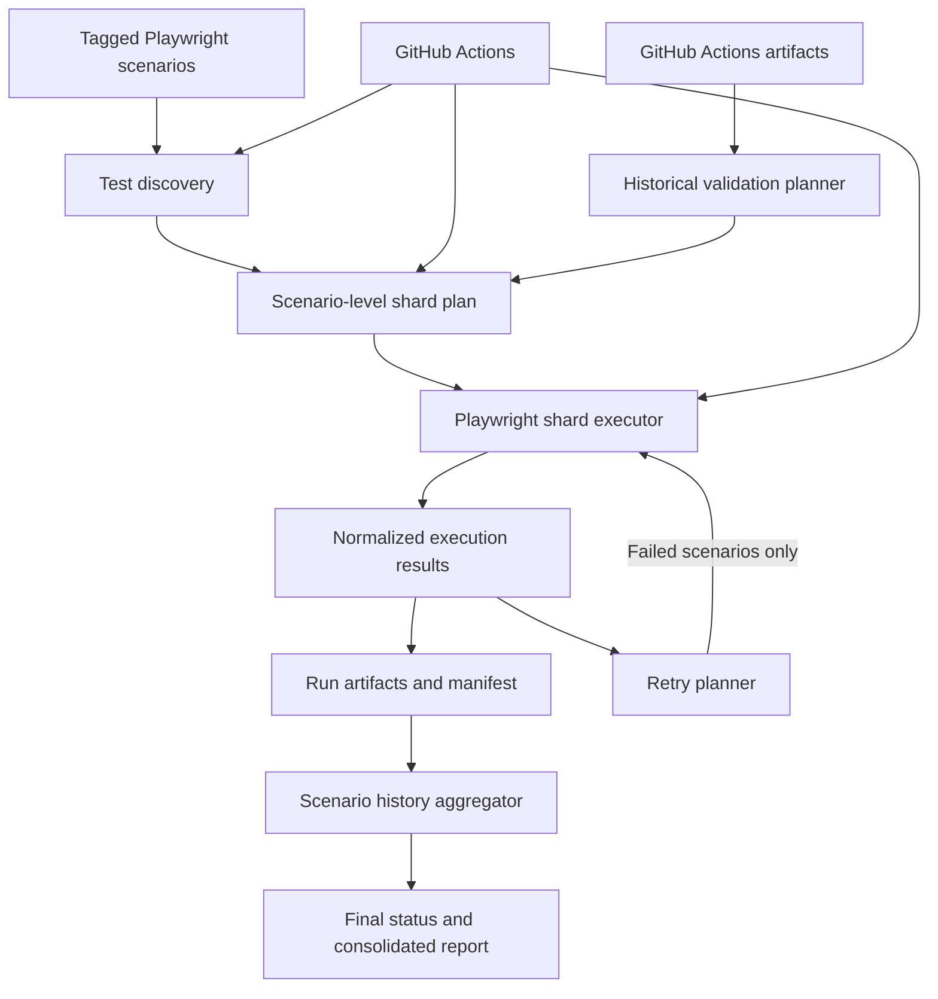

# Playwright JavaScript E2E Framework

A JavaScript end-to-end testing framework built with Playwright Test. It covers UI journeys and API-backed workflows, with an execution layer for scenario discovery, dynamic sharding, retries, run history, and consolidated results.

**Repository:** [github.com/caprisrv/playwright-js-e2e-framework](https://github.com/caprisrv/playwright-js-e2e-framework)

## What it does

- Organizes UI tests around Page Objects and reusable Playwright fixtures.
- Covers Sauce Demo login and cart journeys, plus a Restful Booker reservation journey with API verification and cleanup.
- Discovers individual Playwright scenarios by tag and groups them into dynamically sized shards.
- Executes a shard through Playwright and normalizes its results into JSON artifacts.
- Retries only scenarios that failed in the preceding attempt; earlier results remain available in the execution history.
- Tracks a logical local run with a `runId` and manifest, then aggregates each scenario's attempt history into a final status.
- Builds retry plans and historical-validation plans from GitHub Actions execution artifacts.
- Generates a consolidated Extent-style HTML report from the results for a GitHub Actions run.
- Runs full-suite and historical-validation modes through GitHub Actions, including dynamic shard jobs and automatic retry dispatch.

The repository also contains story understanding and test-plan drafts. AI-assisted exploration, test generation, failure analysis, and automation repair are documented as future direction; they are not implemented framework capabilities today.

## Architecture



The core execution pieces are separated by responsibility:

- `tests/` contains business-level scenarios.
- `pages/`, `fixtures/`, and `api/` hold UI page objects, reusable test setup, and the Restful Booker API client.
- `utils/` contains discovery, sharding, execution, retry, persistence, aggregation, and GitHub result retrieval logic.
- `scripts/` exposes the framework operations used by local workflows and CI.
- `.github/workflows/e2e.yml` coordinates discovery, parallel shard jobs, retries, historical validation, and reporting.

See [docs/framework-architecture.md](docs/framework-architecture.md) for the broader architecture and future AI Quality Engineering direction.

## Requirements

- Node.js and npm (CI currently uses Node.js 26).
- Chromium and its system dependencies for browser tests.
- GitHub CLI (`gh`) and a GitHub token for the GitHub artifact retrieval and reporting scripts.

## Install

```bash
git clone https://github.com/caprisrv/playwright-js-e2e-framework.git
cd playwright-js-e2e-framework
npm ci
npx playwright install --with-deps chromium
```

For local browser runs, create a `.env` file based on `.env.example` and set the credentials required by the tests you intend to run:

```dotenv
E2E_USERNAME=your_saucedemo_username
E2E_PASSWORD=your_saucedemo_password
RESTFUL_BOOKER_USERNAME=your_booking_api_username
RESTFUL_BOOKER_PASSWORD=your_booking_api_password
ENVIRONMENT=qa
```

The Sauce Demo login and cart tests use `E2E_USERNAME` and `E2E_PASSWORD`. The Restful Booker test uses the two `RESTFUL_BOOKER_*` values to retrieve and delete its created booking. Keep real credentials in `.env` or your CI secret store; do not commit them.

## Run tests

Run the complete Playwright suite:

```bash
npm test
```

Run a tagged subset or one spec:

```bash
npx playwright test --grep @regression
npx playwright test tests/cart/add-to-cart.spec.js
```

The project also provides these quality and discovery commands:

```bash
npm run lint
npm run discover -- --tag @regression --scenarios-per-shard 2
```

`npm run discover` lists matching scenarios and prints a JSON shard plan; it does not execute tests.

## Framework execution utilities

Create a dynamic shard plan:

```bash
node scripts/discover-tests.js --tag @regression --scenarios-per-shard 2
```

Execute an already-created shard definition:

```bash
node scripts/execute-shard.js \
  --shard-file artifacts/shard-1.json \
  --run-id local-run-001 \
  --execution-type initial \
  --attempt 0
```

Create a retry plan from persisted execution-result JSON files:

```bash
node scripts/create-retry-plan.js \
  --results-directory artifacts/execution-results \
  --scenarios-per-shard 2 \
  --attempt 1 \
  --output artifacts/retry/retry-plan.json
```

The workflow orchestrator and scripts persist run data under `artifacts/`. A `runId` identifies a logical run, while each initial or retry execution has a separate result file. The latest scenario result determines its final status, and prior attempts remain in its history.

Historical validation selects scenarios that remained failed after the source run and its automatic retries. It retrieves GitHub Actions artifacts, creates a new plan, and runs the unresolved scenarios as a separate validation execution. The source run's recorded results are retained as evidence.

## GitHub Actions

The `E2E Tests` workflow supports:

- Pushes to `main` and a scheduled regression run.
- Manual full-suite runs with an optional tag, scenarios-per-shard value, and retry limit.
- Manual historical validation from a source workflow run ID.
- Automatic retry workflow dispatch for remaining failed scenarios.
- A consolidated Extent-style HTML report after the retry chain completes.

Configure the required test credentials as GitHub Actions secrets. Historical validation and consolidated reporting also require the workflow's GitHub artifact access and token permissions. The workflow includes an AWS identity/read-access verification step, so its configured AWS role must be available to the repository's GitHub Actions environment.

## Project structure

```text
api/                         Restful Booker API client
config/environments/         Playwright base URL configuration
docs/                        Architecture documentation
fixtures/                    Shared Playwright fixtures
pages/                       Page Objects
scripts/                     Discovery, shard, retry, validation, report commands
tests/                       UI and API-backed E2E scenarios
utils/                       Execution, persistence, retry, and aggregation modules
.github/workflows/e2e.yml    CI orchestration
```

## Current scope and roadmap

The deterministic Playwright framework, scenario-level execution utilities, GitHub Actions workflow, historical-validation planning, and report generation are present in the repository. The AI-agent workflow described in the architecture document—story ingestion, application exploration, test generation, failure classification, and repair—is a roadmap, not part of the current runtime.